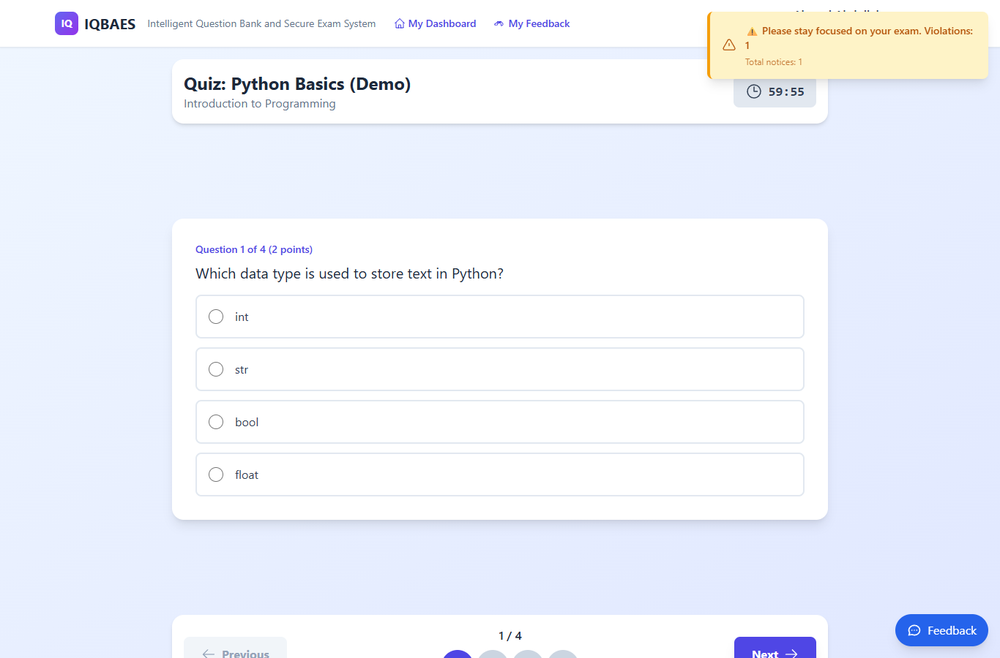
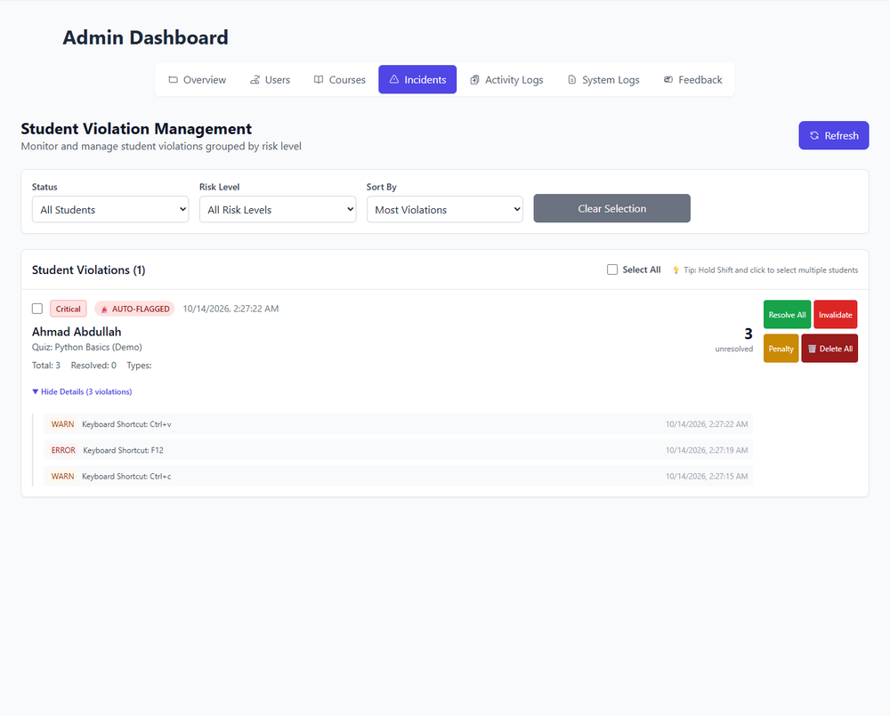
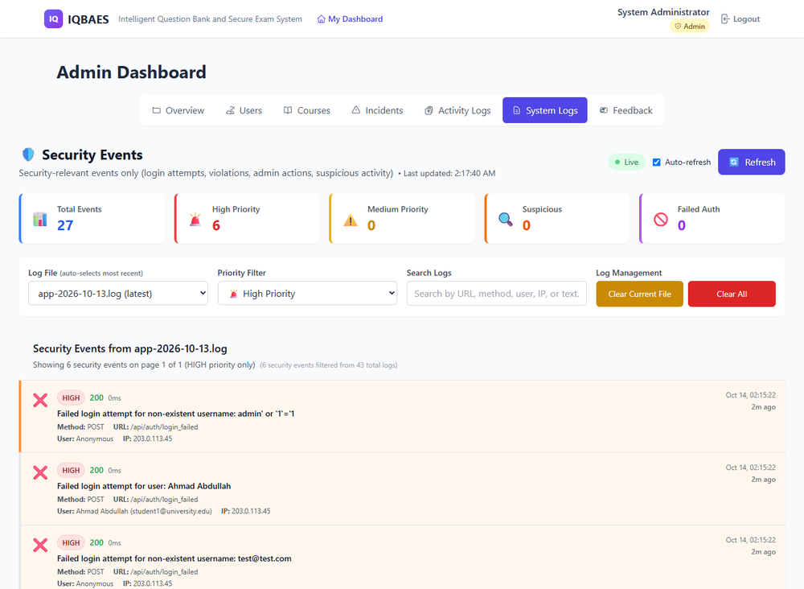

# IQBAES

**Intelligent Question Bank and Secure Exam System.** My final year project: an online exam platform that mixes two things I enjoy, **AI** (it drafts exam questions) and **cybersecurity** (it watches for cheating and for people poking at the login). It has a question bank, grading tools, an anti-cheat watcher and a security log.

🏆 **Top 4 Best Project at ICT Got Talent 5**, organized by the Faculty of Computing and Multimedia, UPTM. Super happy about this one!

> Showcase repo: notes and screenshots only. The source code is private, it runs on my own machine, and all names, accounts and data in the screenshots are generated demo data.

## What problem it tackles

Marking exams by hand is slow, and online exams make it easy to cheat (open another tab, copy a question, search for the answer). I wanted one place where a lecturer can build an exam fast, students sit it online, and the system helps with grading and flags suspicious behaviour.

## Three roles

- **Students** see their available exams, sit them in the browser, practise in a practice centre, and look back at their history and results.
- **Lecturers** build exams, manage a question bank, generate questions with AI, grade answers (including in bulk), allow retakes, and watch exams live.
- **Admins** manage users and courses, and look at activity logs, system logs, feedback and incidents.

## What it does

- **Question bank.** Multiple choice, true or false, short answer and essay questions, with topic, difficulty and marks. Search, filter, and import questions into an exam.
- **AI question generation.** Describe a topic and let Google Gemini draft questions in bulk, then review before using them.
- **Exam builder.** Pick a course, set a duration and an availability window, then add questions manually, from the bank, or with AI.
- **Grading tools.** Lecturers see what is waiting to be graded and can grade answers one by one or in bulk, with a pending-grading counter on the dashboard.
- **Anti-cheat.** While a student sits an exam it notices tab switching and the window losing focus, blocks copy, paste, right-click and common shortcuts, and logs every violation with a time and severity. Warnings are gentle, not harsh. An attempt that broke the rules is marked **Invalidated** with the reason shown (for example a blocked shortcut).
- **Incidents.** A student who breaks the rules is **auto-flagged** and listed with every violation (copy, paste, blocked shortcuts, window switching). The admin can resolve, invalidate the attempt, apply a score penalty, or delete the record.
- **Security log.** Admins see security events in one place: failed logins (even odd, injection-style usernames), violations and admin actions, each with priority, IP address and time.
- **Live monitoring.** Lecturers and admins watch exam sessions and violations as they happen (Socket.IO).
- **Retake management** and **feedback** from users to admins.
- **Installable** as an app on a phone (PWA).

## Security side

Security is a big part of this project, not an add-on:

- **Anti-cheat for students**: tab switching, copy, paste, right-click and blocked shortcuts are caught and reported to the server, and a student with many violations is auto-flagged.
- **Security log for admins**: failed logins (including odd, injection-style usernames), violations and admin actions, with priority, IP address and time.
- **Answers stay on the server.** Students never receive the correct answers. Marking (multiple choice, true or false, and AI-graded short answers) happens on the server.
- **Only the right people can sign up and watch.** Self-registration always creates a student; lecturers and admins are created by an admin. Live monitoring needs a login, and only lecturers and admins can watch exams.
- **Strict exam rules.** A submission is accepted only from an enrolled student with a running session, inside the exam time, one at a time.
- **Controlled AI.** AI calls are limited per user, marks given by the AI are capped at what the question is worth, and the student's text is treated as data, not as instructions.
- **Hardened API**: JWT login with a separate refresh secret, bcrypt password hashing, Helmet security headers, rate limiting (50 login attempts per 15 minutes), input validation, small request-size limits, role checks on the server, and the client IP taken from the trusted proxy only, so it cannot be faked in the logs.
- **Tested.** Automated tests cover these rules: hidden answers, registration, grading, password reset, and the socket login.

## Screens

**Lecturers build exams** by hand, from the question bank, or with AI.

| A student copies during an exam: alarm | The admin sees the student auto-flagged |
| --- | --- |
|  |  |
| **Security log: outsider login attempts** | **Exam history: the attempt is invalidated** |
|  |  |

> The failed logins in the security log are me probing my own local demo with fake usernames from a placeholder IP address, to show how the system reacts.

## Built with

- **Frontend:** React, TypeScript, Vite
- **Backend:** Node.js, Express
- **Database:** MongoDB with Mongoose
- **Real time:** Socket.IO
- **AI:** Google Gemini API
- **Security:** JWT login, bcrypt password hashing, Helmet headers, rate limiting, input validation, role-based access

## Design notes

- Anti-cheat alerts are throttled and worded calmly, so honest students are not nagged and the lecturer still sees every violation in the logs.
- Student, lecturer and admin are separate roles with their own dashboards, and the API checks the role on the server, not only in the interface.
- Logins, security events, system events and audit trails are stored in separate collections, so the admin can trace what happened.

Made by **KH4I**
