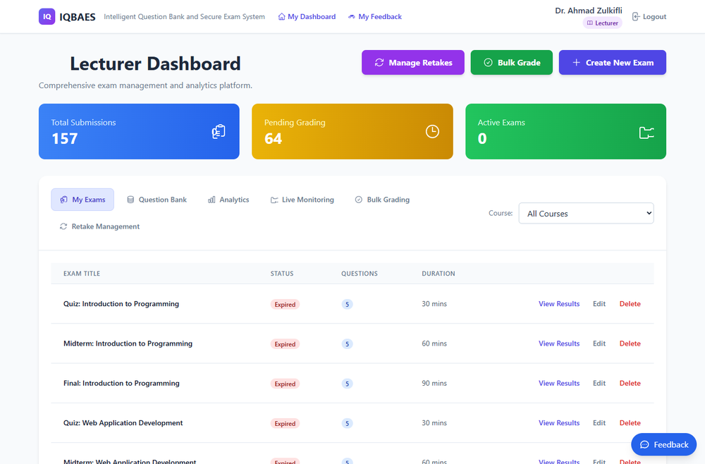
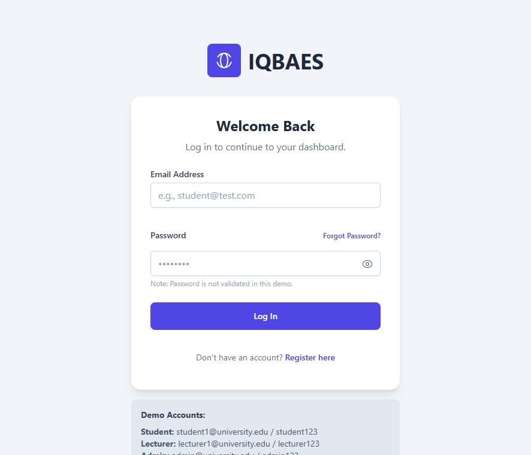
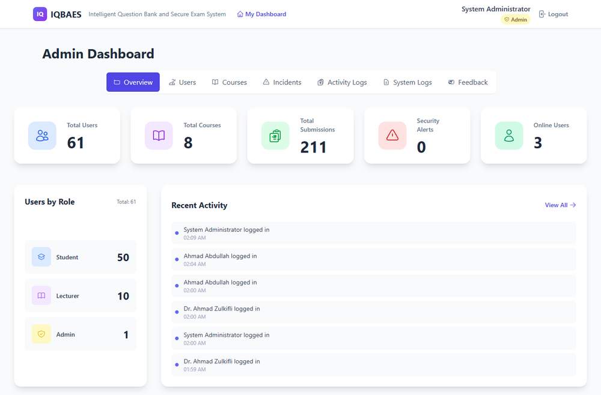
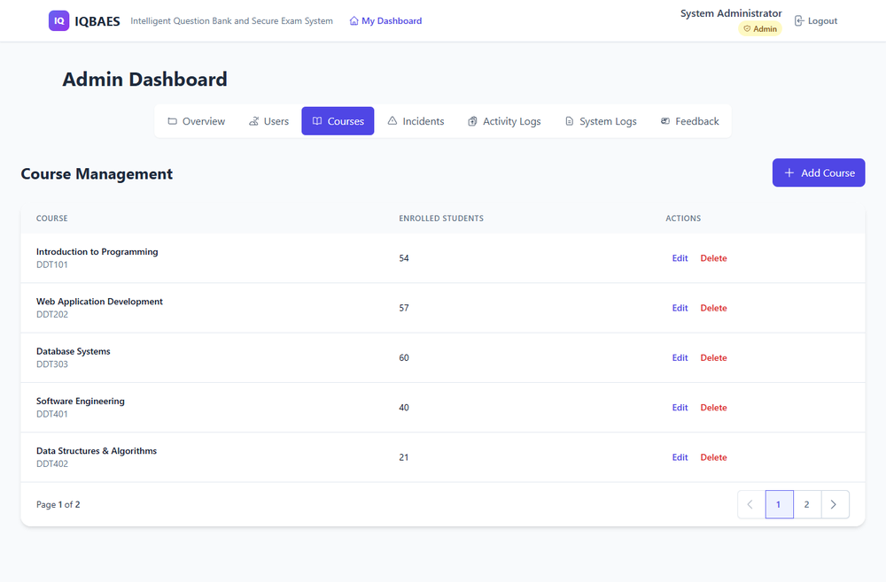
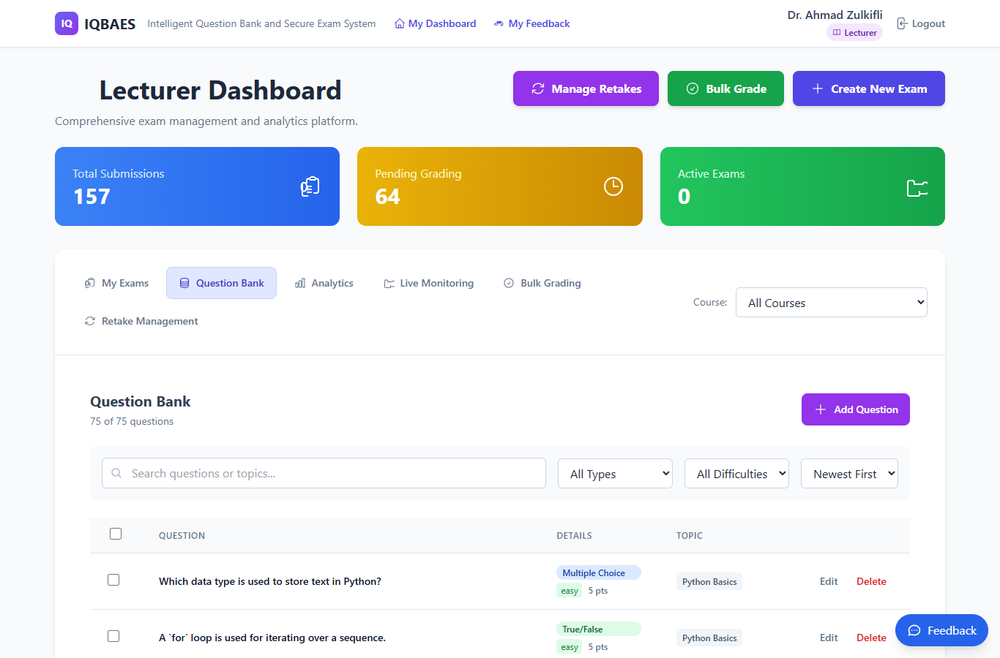
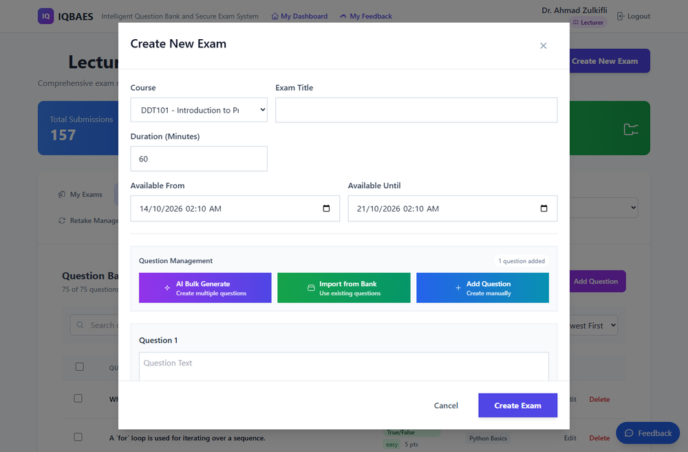
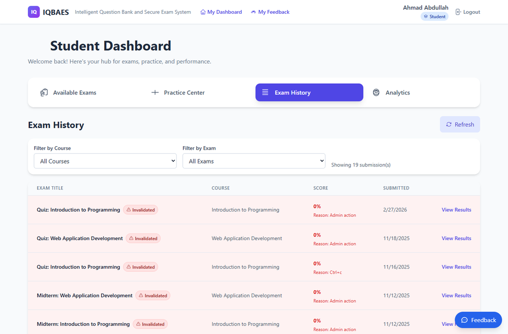

# IQBAES

**Intelligent Question Bank and Secure Exam System.** My final year project: an online exam platform with a question bank, AI-made questions, grading tools and a built-in anti-cheat watcher.

🏆 **Top 4 Best Project at ICT Got Talent 5**, organized by the Faculty of Computing and Multimedia, UPTM. Super happy about this one!

> Showcase repo: notes and screenshots only. The source code is private, it runs on my own machine, and all names, accounts and data in the screenshots are generated demo data.

## What problem it tackles

Marking exams by hand is slow, and online exams make it easy to cheat (open another tab, copy a question, search for the answer). I wanted one place where a lecturer can build an exam fast, students sit it online, and the system helps with grading and flags suspicious behaviour.

## Three roles

- **Students** see their available exams, sit them in the browser, practise in a practice centre, and look back at their history and results.
- **Lecturers** build exams, manage a question bank, generate questions with AI, grade answers (including in bulk), allow retakes, and watch exams live.
- **Admins** manage users and courses, and look at activity logs, system logs, feedback and incidents.

## What it does

- **Question bank.** Multiple choice, true or false, short answer and essay questions, with topic, difficulty and marks. Search, filter, and import questions into an exam.
- **AI question generation.** Describe a topic and let Google Gemini draft questions in bulk, then review before using them.
- **Exam builder.** Pick a course, set a duration and an availability window, then add questions manually, from the bank, or with AI.
- **Grading tools.** Lecturers see what is waiting to be graded and can grade answers one by one or in bulk, with a pending-grading counter on the dashboard.
- **Anti-cheat.** While a student sits an exam it notices tab switching and the window losing focus, blocks copy, paste, right-click and common shortcuts, and logs every violation with a time and severity. Warnings are gentle, not harsh. An attempt that broke the rules is marked **Invalidated** with the reason shown (for example a blocked shortcut).
- **Live monitoring.** Lecturers and admins watch exam sessions and violations as they happen (Socket.IO).
- **Retake management** and **feedback** from users to admins.
- **Installable** as an app on a phone (PWA).

## Screens

The lecturer dashboard: submissions, pending grading, and the exam list.

| Login | Admin dashboard |
| --- | --- |
|  |  |
| **Admin: courses** | **Lecturer: question bank** |
|  |  |
| **Lecturer: create exam** | **Student: exam history** |
|  |  |

## Built with

- **Frontend:** React, TypeScript, Vite
- **Backend:** Node.js, Express
- **Database:** MongoDB with Mongoose
- **Real time:** Socket.IO
- **AI:** Google Gemini API
- **Security:** JWT login, bcrypt password hashing, Helmet headers, rate limiting, input validation, role-based access

## Design notes

- Anti-cheat alerts are throttled and worded calmly, so honest students are not nagged and the lecturer still sees every violation in the logs.
- Student, lecturer and admin are separate roles with their own dashboards, and the API checks the role on the server, not only in the interface.
- Logins, security events, system events and audit trails are stored in separate collections, so the admin can trace what happened.

Made by **KH4I**
